# Midas Client Portal - Jobber customer portal (Flutter)

A customer self-service portal for a commercial facility services company. Clients see their
sites and recurring services, submit service requests with photos, ask for changes, follow
each job from **Requested -> Scheduled -> In progress -> Completed**, browse before/after
photos of finished work, read invoices synced from QuickBooks, and chat with their account
manager. One Flutter codebase runs on iOS, Android and the web.

The integration layer is shaped like the real systems: a Jobber GraphQL client (queries for
client, properties, jobs, visits and the `requestCreate` mutation), a read-only QuickBooks
Online invoice client, and a GoHighLevel client for conversations and pipeline
opportunities. In this demo they answer from fixtures, so swapping in live API calls is a
transport change, not a UI change.

## Demo

| iOS | Android |
|---|---|
| 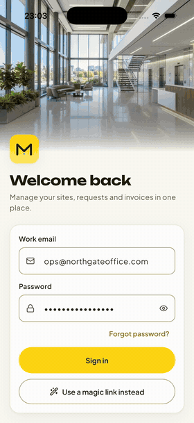 | 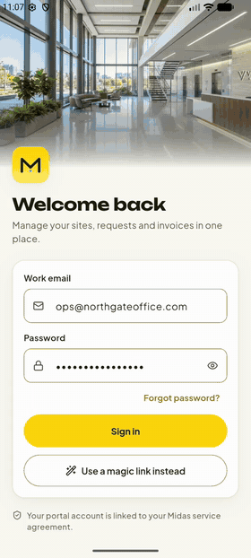 |

Same codebase running on both platforms.

## Screenshots

| Sign in | Home | Site |
|---|---|---|
| 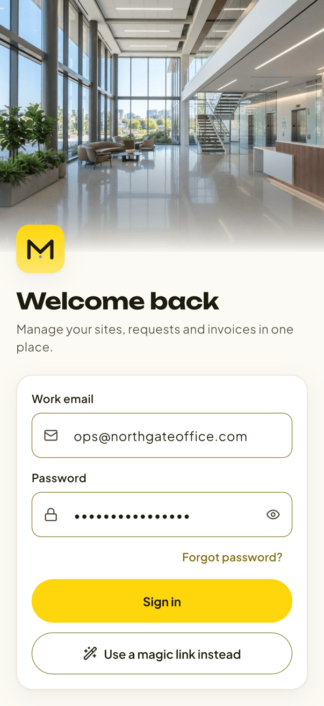 | 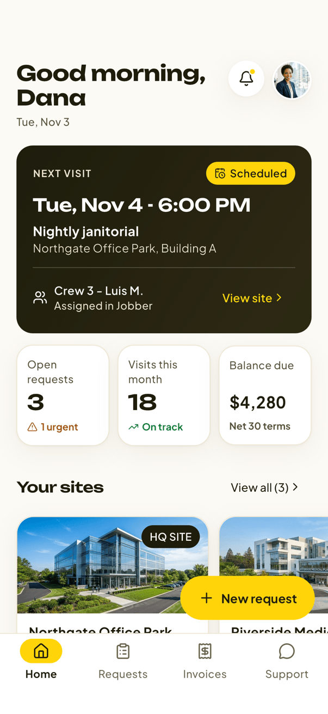 | 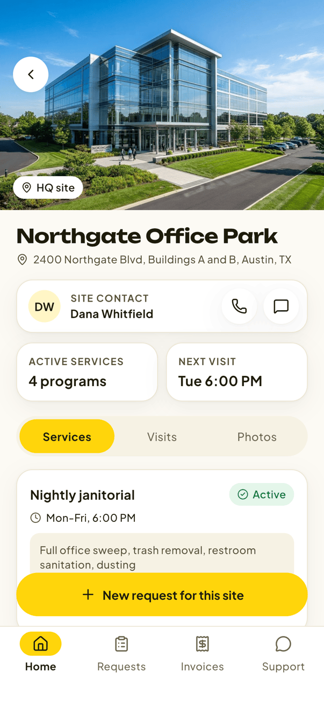 |

| Request a change | New request with photos | Request received |
|---|---|---|
| 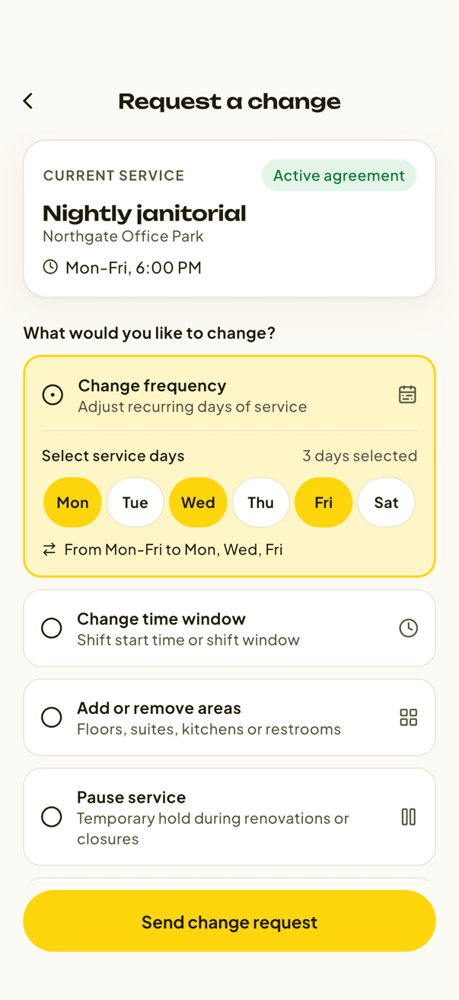 | 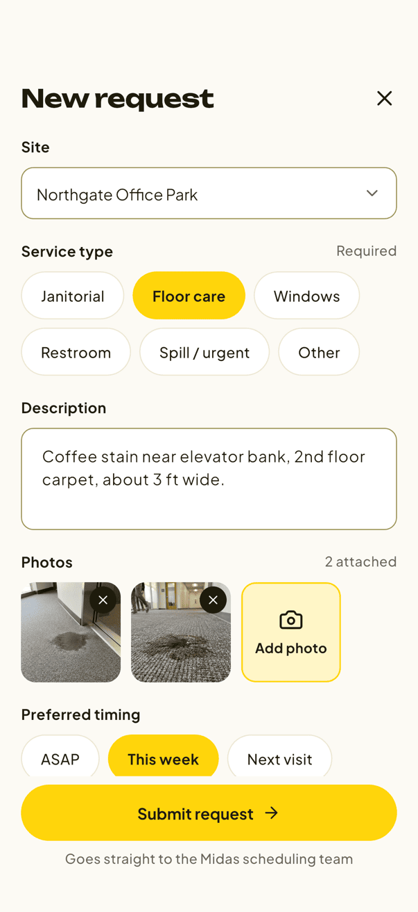 | 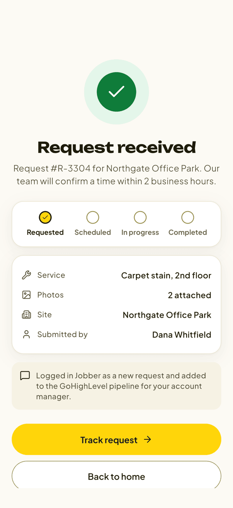 |

| Job status timeline | Requests | Completed work |
|---|---|---|
| 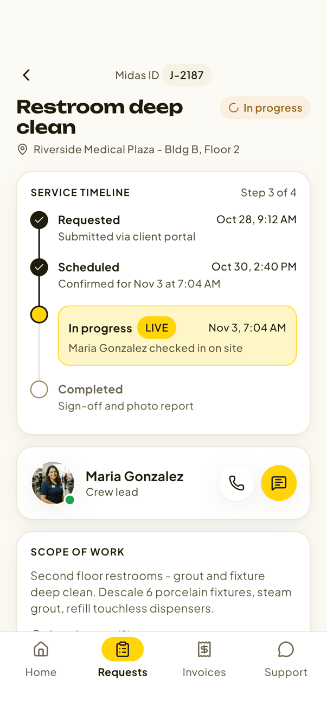 | 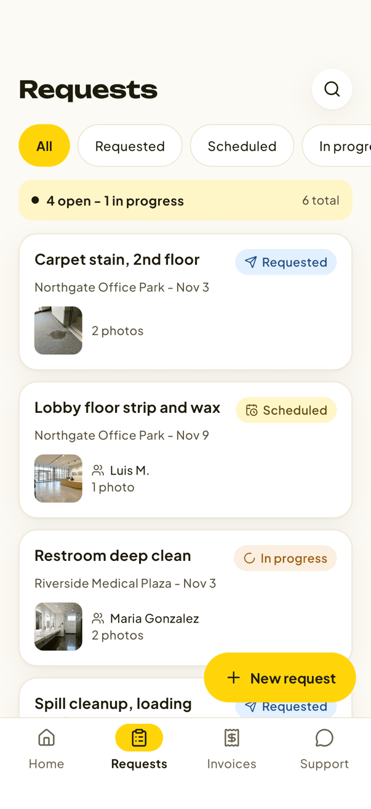 | 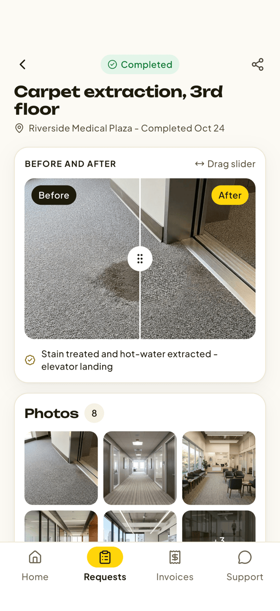 |

| Invoices | Invoice detail | Support chat |
|---|---|---|
| 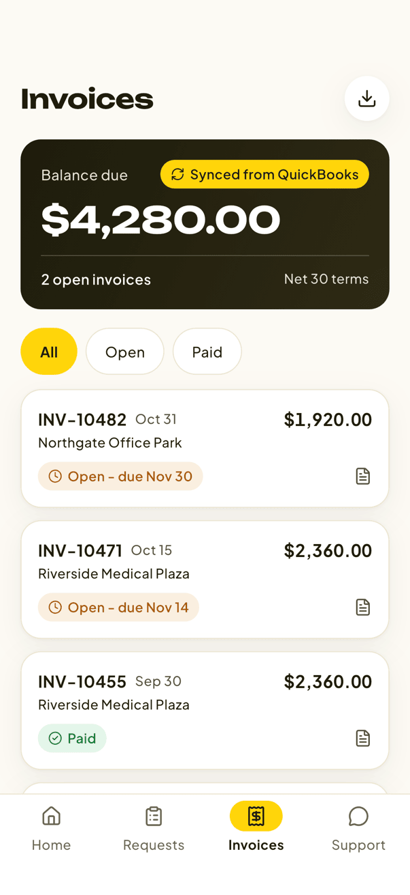 | 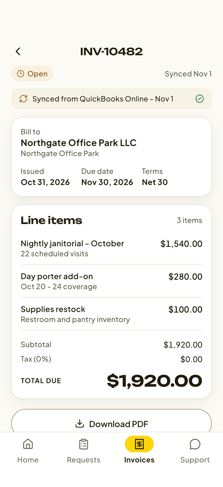 | 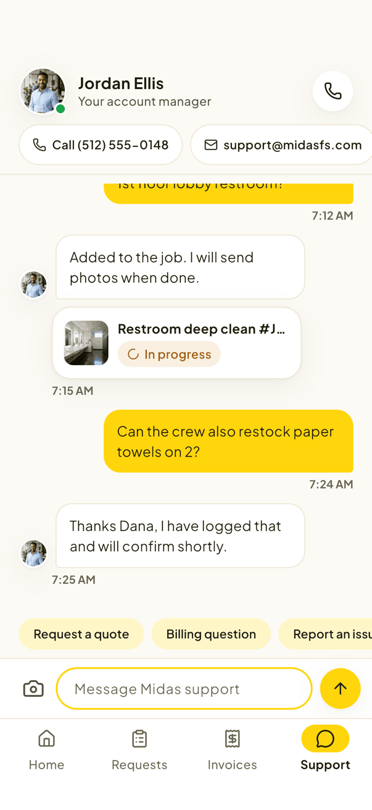 |

| Notifications | Account | First-run home |
|---|---|---|
| 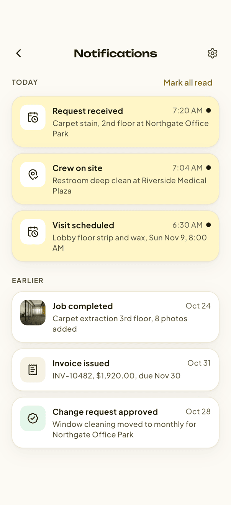 | 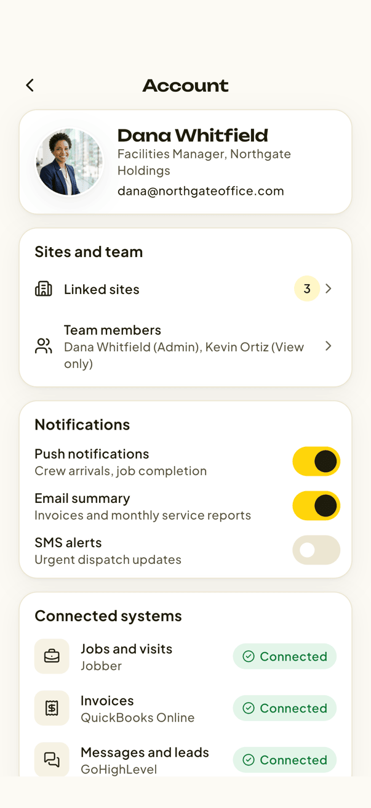 | 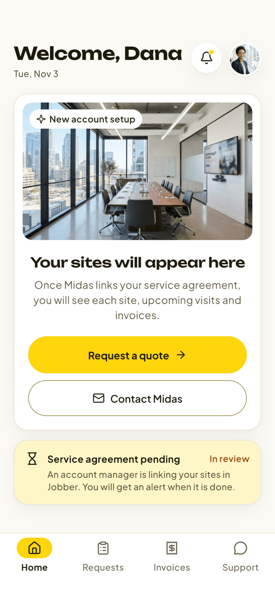 |

## What it shows

- **Sites and services** - each property with its recurring services (nightly janitorial,
  day porter, window cleaning, carpet extraction) pulled from Jobber recurring jobs.
- **Service requests with photos** - pick a site and service type, describe the issue,
  attach photos, choose timing. The request is created in Jobber (`requestCreate`) and
  mirrored to GoHighLevel as a pipeline opportunity for the account manager.
- **Request a change** - change frequency (day picker), time window, areas, pause or cancel,
  with an effective date and notes.
- **Job status timeline** - Requested, Scheduled, In progress (live), Completed, with the crew
  lead, scope of work and attachments, plus a "synced with Jobber" stamp.
- **Completed work** - draggable before/after comparison, full-screen photo gallery, crew
  notes with sign-off, and a visit rating.
- **Invoices (read-only)** - balance due, open and paid invoices, line items, and a
  "Synced from QuickBooks Online" label on every invoice. No payment button by design.
- **Support** - chat thread with the account manager (GoHighLevel conversations), quick
  replies, call and email shortcuts.
- **Notifications** - crew on site, visit scheduled, job completed, invoice issued, change
  approved, each deep-linking to the right screen.
- **Account** - linked sites, team members, notification preferences, connected systems.

## App flow

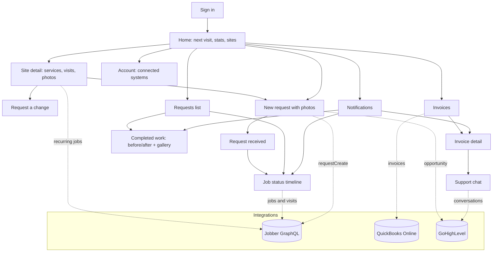

## Architecture

```
lib/
  data/
    models.dart                  portal models (Property, Job, Invoice, ChatMessage, ...)
    jobber/queries.dart          GraphQL documents sent to Jobber
    jobber/jobber_client.dart    JobberGraphQLClient + MockJobberClient (fixture responses)
    quickbooks/                  read-only QuickBooks Online invoice client
    gohighlevel/                 conversations + opportunity client
    portal_repository.dart       maps API shapes into portal models
  state/providers.dart           Riverpod providers and notifiers
  features/                      one folder per area (home, property, requests, invoices, ...)
  widgets/                       shared components (cards, status chips, tab shell)
  theme/app_theme.dart           design tokens (lemon + ink palette, Plus Jakarta Sans / Unbounded)
design/                          source design per screen (HTML), DESIGN.md, brief.json
integration_test/                end-to-end flow that also captures the screenshots
```

- **State**: Riverpod. `jobsProvider` (AsyncNotifier) owns jobs and requests, `chatProvider`
  owns the conversation, `noticesProvider` owns notifications, small notifiers hold filters
  and the request draft.
- **Navigation**: go_router with a `StatefulShellRoute` for the four tabs (Home, Requests,
  Invoices, Support) and root-level routes for modal flows.
- **Integrations**: the three clients are injected through providers, so a live build only
  overrides `jobberClientProvider`, `quickbooksClientProvider` and `ghlClientProvider`.
  Tokens for Jobber, QuickBooks and GoHighLevel stay on a small backend, never in the app.
- **Hardware-free demo**: photo capture is simulated (tapping Add photo attaches a sample site
  photo), so every screen runs on a simulator.

## Run

```sh
flutter pub get
flutter run            # iOS simulator or Android emulator
flutter run -d chrome  # web portal
```

Requires Flutter 3.44+ (Dart 3.12). Fonts are bundled, so the app runs offline.
